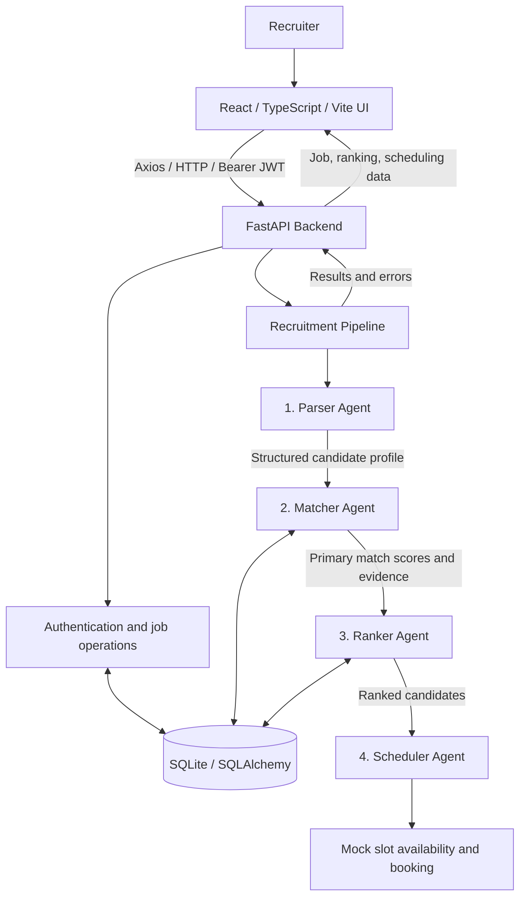
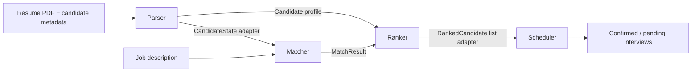

# Recruitment Screener & Interview Scheduler

An AI-assisted recruitment application that helps recruiters manage job descriptions, screen resumes against job requirements, maintain an evidence-based candidate leaderboard, and assign interview slots to shortlisted candidates.

The system combines a **React + TypeScript frontend**, a **FastAPI backend**, a **SQLAlchemy/SQLite persistence layer**, and **four independently compiled LangGraph agents** coordinated by a recruitment pipeline.

> **Project status:** This repository includes a working agent architecture and a generated frontend. Interview availability and booking are currently mocked. The architecture below describes the known implementation; confirm deployment configuration and exact API endpoints against the source before production use.

## Architecture



**Architectural boundary:** The four agents are separate LangGraph graphs. The pipeline coordinates them; they are not nodes of one monolithic graph. The backend provides the HTTP/API boundary and persistence access.

## What the application does

1. **Authentication and job management:** Recruiters register or log in, access protected pages, and manage job descriptions.
2. **Resume parsing:** The Parser extracts text from PDF resumes and produces structured candidate profiles.
3. **Candidate matching:** The Matcher compares each candidate with a job-specific ideal profile and generates evidence-backed section scores.
4. **Candidate ranking:** The Ranker calculates secondary evaluation scores, updates a job-specific leaderboard, and persists ranking records.
5. **Interview scheduling:** The Scheduler selects the top candidates and attempts to book available interviewer/slot combinations.

The frontend provides dashboard, job detail, candidate ranking, screening, and interview scheduling UI components. The exact behavior of each generated component should be checked in its source.

## Technology stack

| Layer | Technology | Purpose |
| --- | --- | --- |
| Frontend | React 19, TypeScript, Vite 8 | User interface and development tooling |
| UI | Tailwind CSS 4, Lucide React | Styling and icons |
| Navigation | React Router 7 | Client-side routing and protected pages |
| HTTP client | Axios | Requests to the backend with JWT bearer headers |
| Backend | FastAPI | API, authentication, and orchestration integration |
| Persistence | SQLAlchemy, SQLite | Jobs, candidates, rubrics, and rankings |
| Agent workflows | LangGraph | Stateful per-agent execution graphs |
| LLM integration | LangChain prompts, JSON output parsing, configured LLM provider | Structured extraction and evaluations |
| Resume extraction | PyMuPDF | Reading PDF resume text |
| Scheduling | Python mock tools | Slot lookup and in-memory booking |

## Agent workflow



### 1. Parser Agent

**Input:** Resume PDF, candidate ID, and optional project-specific PEP metadata.

**Process:** Extracts PDF text, then uses LLM-driven steps to derive contact details, skills, tools and technologies, education, coursework, work experience, certifications, and achievements.

**Output:** A structured candidate profile that the Matcher adapter transforms into its expected state.

### 2. Matcher Agent

**Input:** Candidate profile, job ID, and job description.

**Process:** Reuses an existing job-specific ideal-candidate profile or generates one. Evaluates nine areas: technical skills, soft skills, tech stacks, tools/platforms, certifications, work experience, coursework, achievements, and education. Validates section evidence and scores; validation failures can trigger limited retries.

**Output:** A `MatchResult` containing candidate ID, nine section evaluations, and the weighted **primary `overall_score`**.

### 3. Ranker Agent

**Input:** One matched candidate at a time, together with the original candidate profile and job context.

**Process:** Reuses or generates a secondary rubric with exactly three criteria: `relevant_experience`, `project_impact`, and `problem_solving`. Scores these from Matcher evidence, calculates a weighted **secondary score**, loads existing rankings, and updates the leaderboard.

**Ranking policy:** Sort by primary score descending, then secondary score descending. Identical score pairs share a rank (**competition ranking**, e.g. 1, 2, 2, 4). Rankings are persisted per job and candidate.

### 4. Scheduler Agent

**Input:** Ranked candidates and a `top_n` selection limit.

**Process:** Selects the first `top_n` candidates from an already sorted list, obtains slot/interviewer pairs, and attempts bookings sequentially. On a failed booking it tries the next slot; if none succeeds, the candidate remains `pending`.

**Output:** Interview assignments with `confirmed` or `pending` status, plus booking errors.

> **Important:** The Scheduler currently uses hard-coded availability slots dated November 20, 2026, and an in-memory `booked_slots` set. It does not provide real-time calendar availability, durable booking storage, invitations, or automatic filtering of expired slots.

## Data and persistence

The known database model includes:

| Model | Responsibility |
| --- | --- |
| `JobDescription` | Job details and requirements |
| `Candidate` | Candidate identity/contact details and ingestion identifier |
| `IdealCandidateModel` | Reusable ideal-candidate profile per job |
| `JobRankingRubric` | Reusable secondary evaluation rubric per job |
| `CandidateRanking` | Per-job/per-candidate scores, evidence, rationale, and leaderboard rank |

The Matcher and Ranker interact with the database to reuse job-specific evaluation criteria. The Ranker loads and upserts candidate ranking records. Scheduling mock bookings are **not** stored in the database.

## Frontend structure

```text
frontend/
├── public/
├── src/
│   ├── api/
│   │   └── Client.ts
│   ├── components/
│   │   ├── CandidateRankings.tsx
│   │   ├── CreateJobForm.tsx
│   │   ├── DashboardLayout.tsx
│   │   ├── DashboardStats.tsx
│   │   ├── InterviewScheduler.tsx
│   │   └── ScreenCandidatesButton.tsx
│   ├── pages/
│   │   ├── Dashboard.tsx
│   │   ├── JobDetails.tsx
│   │   ├── Login.tsx
│   │   └── Register.tsx
│   ├── App.tsx
│   ├── main.tsx
│   └── index.css
└── package.json
```

Routes defined in `App.tsx`:

| Path | Page | Client-side token check |
| --- | --- | --- |
| `/login` | Login | No |
| `/register` | Register | No |
| `/dashboard` | Dashboard | Yes |
| `/jobs/:jobId` | Job details | Yes |

The frontend stores `access_token` in `sessionStorage`; the Axios client attaches it as an `Authorization: Bearer` header. A frontend token-presence check is not a substitute for backend token validation and authorization.

## Repository layout

```text
Recruitment-Screener-and-Interview-Scheduler/
├── agents/
│   ├── README.md
│   ├── parser/
│   ├── matcher/
│   ├── ranker/
│   ├── scheduler/
│   │   └── tools/
│   └── pipeline/
├── backend/
│   └── README.md
├── frontend/
│   └── README.md
└── README.md
```

This is a **high-level view**, not an exhaustive inventory of backend or pipeline files.

## Getting started

### Prerequisites

- Python environment and dependencies appropriate to the backend/agent code
- Node.js and npm compatible with the project's Vite version
- Configured LLM provider credentials or local provider, as required by the agent implementation
- Backend database and any necessary initialization/migrations

### Frontend

```bash
cd frontend
npm install
```

Create `frontend/.env` if you need to override the default backend URL:

```env
VITE_API_BASE_URL=http://127.0.0.1:8000
```

Start the development server:

```bash
npm run dev
```

Other frontend commands:

```bash
npm run build
npm run lint
npm run preview
```

### Backend and agents

Configure the backend Python environment, database, authentication settings, and LLM provider according to the actual project configuration. Start the FastAPI application using the import path defined in your backend source. **An exact backend launch command is intentionally not prescribed here because the entry point has not been verified.**

Run the frontend and backend together to use the UI. The frontend API client defaults to `http://127.0.0.1:8000` unless `VITE_API_BASE_URL` is set.

## Reliability and current limitations

- **Mock scheduling:** Slot availability is static and bookings are stored only in process memory; restarting the process loses booked state.
- **Expired mock slots:** The predefined slot dates can be in the past and are not filtered by the mock tool.
- **LLM variability:** Parsing and evaluation depend on model output; structured parsing and validation reduce, but do not eliminate, errors.
- **Failure boundaries:** The Matcher has validation retries; the Ranker stops its graph on recorded errors; the Scheduler records booking failures and may return pending candidates.
- **Authentication:** Frontend route protection checks token presence; the backend must enforce JWT validation and access control.
- **Concurrency and idempotency:** Production scheduling and ranking should use transactional, durable operations and account for concurrent requests.
- **Observability:** Production deployment would benefit from structured tracing, request/job correlation, and per-agent latency/error metrics.

## Documentation

For implementation details, consult the component READMEs:

- [Agents — overall architecture](agents/README.md)
- [Parser Agent](agents/parser/README.md)
- [Matcher Agent](agents/matcher/README.md)
- [Ranker Agent](agents/ranker/README.md)
- [Scheduler Agent](agents/scheduler/README.md)
- [Backend](backend/README.md)
- [Frontend](frontend/README.md)

## Next steps

Replace mock scheduling with persistent availability and calendar integration, add robust job-level workflow tracing and retry policies, verify end-to-end API integration, and strengthen concurrency and deployment safeguards before production use.
