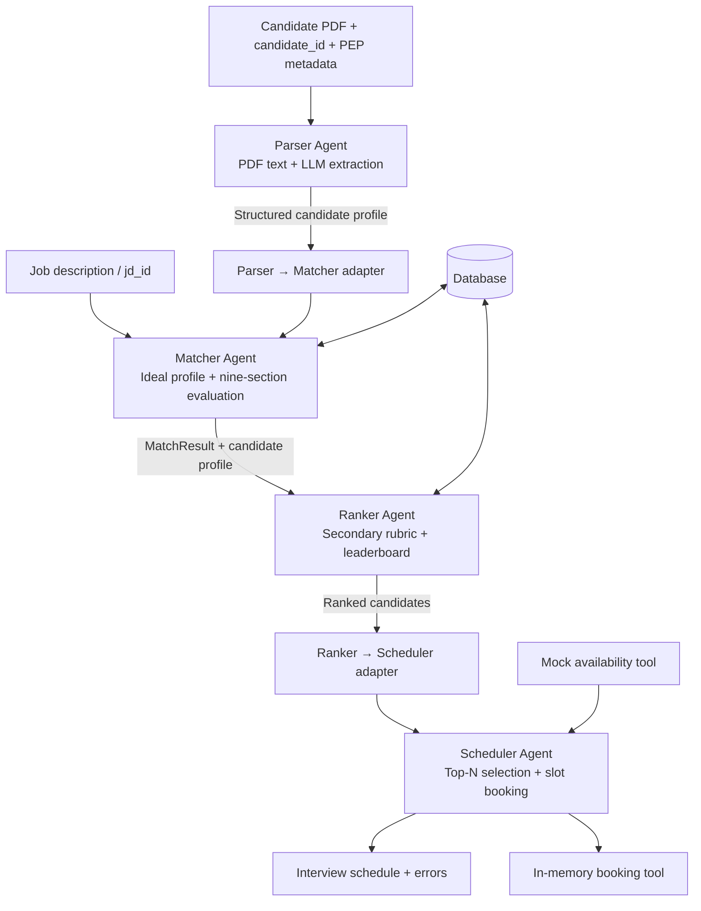
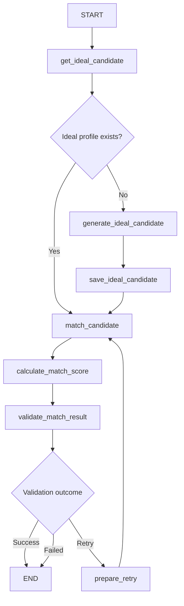
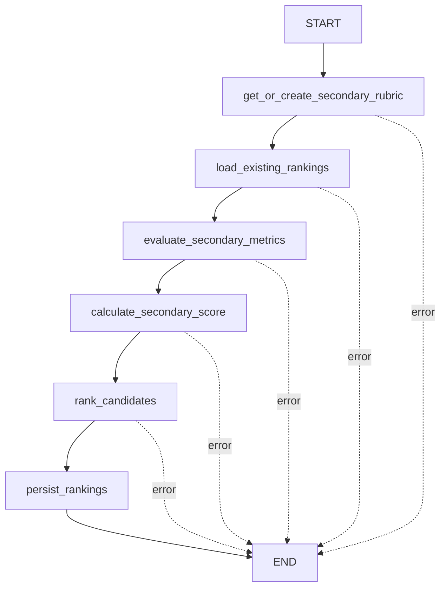
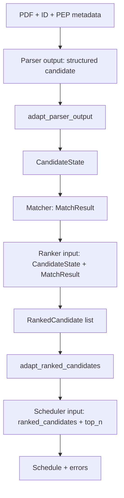

# Recruitment Screener and Interview Scheduler — Agent Architecture

This directory contains four specialized **LangGraph agents** that turn uploaded resumes into structured candidate profiles, evaluate them against a job description, maintain a ranked leaderboard, and assign interview slots. The agents are **separate compiled graphs** connected by the recruitment pipeline and explicit data adapters—not a single shared LangGraph.

> **Scope:** This README describes the agent layer and its interactions. For implementation details, see the README in each agent directory. The Scheduler's availability and booking tools are currently mocks, not a production calendar integration.

## System architecture



### Execution at a glance

| Agent | Receives | Produces | Side effects |
| --- | --- | --- | --- |
| **Parser** | PDF bytes, candidate ID, PEP metadata | Structured candidate profile | LLM calls; no candidate DB write in the Parser itself |
| **Matcher** | Job ID/description, adapted candidate | `MatchResult`: nine section scores, evidence, weighted primary score | Reads or creates a persisted ideal-candidate profile |
| **Ranker** | Job ID/description, candidate profile, `MatchResult` | Updated ranked leaderboard | Reads/creates job rubric; loads and upserts candidate rankings |
| **Scheduler** | Ranked candidates and `top_n` | Confirmed/pending interview entries and booking errors | Uses mock slot inventory and process-local booked-slot set |

The pipeline also saves candidate records outside the Parser before downstream database operations. It processes candidates through Parser → Matcher → Ranker, then sends the accumulated leaderboard to Scheduler. The precise pipeline API is defined outside `agents/` and should be checked in `agents/pipeline/` before relying on its call signature.

## Directory structure

```text
agents/
├── README.md                  # This overview (save this file here)
├── parser/
│   ├── README.md
│   ├── graph.py
│   ├── main.py
│   ├── nodes.py
│   ├── prompts.py
│   ├── schemas.py
│   └── state.py
├── matcher/
│   ├── README.md
│   ├── adapter.py
│   ├── graph.py
│   ├── main.py
│   ├── nodes.py
│   ├── prompts.py
│   ├── schemas.py
│   └── state/
│       ├── candidate.py
│       ├── ideal_candidate.py
│       ├── matcher_state.py
│       └── match_result.py
├── ranker/
│   ├── README.md
│   ├── graph.py
│   ├── main.py              # Currently empty
│   ├── nodes.py
│   ├── prompts.py
│   ├── schemas.py
│   └── state.py
└── scheduler/
    ├── README.md
    ├── adapter.py
    ├── graph.py
    ├── nodes.py
    ├── state.py
    └── tools/
        ├── availability.py
        └── booking.py
```

## 1. Parser Agent — Resume understanding

The Parser converts an uploaded PDF into a normalized candidate profile. It uses **PyMuPDF** to extract page text and LangChain prompt/LLM/parser chains to extract structured fields.


Its output includes candidate ID, name, email, mobile number, LinkedIn URL, technical and soft skills, technology stacks, tools/platforms, certifications, experience, coursework, achievements, education, and PEP metadata. The Parser does **not** decide candidate suitability.

**Entry point:** `agents.parser.main.process_resume(...)` is asynchronous and invokes the compiled resume graph. The pipeline is responsible for subsequent candidate persistence.

**Implementation caveats:** The supplied Parser has a coursework type inconsistency (`str` vs. `list[str]`), a `technologies` field that is not populated by its domain extraction node, and no explicit recovery loop for PDF/LLM failures. See `parser/README.md`.

## 2. Matcher Agent — Job-description alignment

The Matcher compares one structured candidate against a **job-specific ideal candidate profile**. If the profile is already stored for `jd_id`, it is reused; otherwise, an LLM generates and persists it.



The Matcher evaluates **nine sections**: `technical_skills`, `soft_skills`, `tech_stacks`, `tools_and_platforms`, `certifications`, `work_experience`, `coursework`, `achievements`, and `education`.

Each section records a 0–100 score, justification, matched items, missing items, and supporting evidence. The ideal profile defines section weights; the primary score is the weighted mean:

\[
\text{primary score} = \operatorname{round}\left(\frac{\sum_i \text{section score}_i \times \text{weight}_i}{\sum_i \text{weight}_i}, 2\right)
\]

The Matcher validates required sections, score ranges, evidence, and the final score. Invalid evaluations can be sent through its retry path; the graph limits retries rather than looping indefinitely.

**Handoff:** `agents.matcher.adapter.adapt_parser_output(parsed_candidate)` converts the Parser output into `CandidateState`. The Matcher emits `match_result` with `candidate_id`, `match_scores`, and `overall_score`.

## 3. Ranker Agent — Secondary evaluation and leaderboard

The Ranker accepts **one candidate at a time** from the Matcher. It loads the existing leaderboard for the job, evaluates the incoming candidate using a separate job-specific rubric, updates ranks, and persists the resulting leaderboard.



The secondary rubric has **exactly three criteria**: `relevant_experience`, `project_impact`, and `problem_solving`. Its generated nonnegative weights are normalized to sum to **1.0** and the rubric is reused for the same job.

The Ranker evaluates only the Matcher-provided evidence. Each criterion gets a score from 0–100, a justification, and an evidence status (`sufficient`, `partial`, `insufficient`, or `contradictory`). **Insufficient evidence receives a neutral score of 50**, not an automatic failure.

\[
\text{secondary score} = \operatorname{round}\left(\frac{\sum_j \text{criterion score}_j \times \text{weight}_j}{\sum_j \text{weight}_j}, 2\right)
\]

### Ranking policy

1. Sort by **Matcher `overall_score` descending**.
2. Break ties using **Ranker `secondary_score` descending**.
3. If both scores match, assign the **same competition rank**; the next rank skips positions.
4. If a candidate already exists for the job, replace their leaderboard entry and recalculate ranks.

| Candidate | Primary score | Secondary score | Rank |
| --- | ---: | ---: | ---: |
| Alice | 95 | 80 | 1 |
| Bob | 90 | 85 | 2 |
| Charlie | 90 | 85 | 2 |
| David | 88 | 99 | 4 |

The Ranker persists `CandidateRanking` rows containing primary and secondary scores, evaluation details, rank, and rationale. `JobRankingRubric` stores the reusable rubric. It exposes `ranker_graph` from `agents.ranker.graph`; its `main.py` is currently empty.

**Error behavior:** Most nodes stop the graph if `errors` is nonempty. Error objects include a `retryable` flag, but the Ranker graph does **not** implement automatic retries.

## 4. Scheduler Agent — Top-N interviews

The Scheduler receives the ranked leaderboard through `adapt_ranked_candidates`, which maps `overall_score` to `ranking_score` while retaining `candidate_id`, `candidate_name`, and `rank`.


`select_candidates` takes `ranked_candidates[:top_n]`. **It assumes the input is already sorted** by the Ranker. `fetch_availability` calls the mock `get_available_slots()`. `assign_interviews` attempts bookings in slot order, skips slots already attempted in the current run, and falls back to the next slot if a booking fails.

- A successful booking produces a **`confirmed`** schedule entry with the slot start/end time and interviewer ID/name.
- If no slot can be booked, the candidate receives a **`pending`** entry with no slot or interviewer.
- Failed booking attempts are recorded as error strings; a later successful booking does not erase them.

**Mock boundaries:** `tools/availability.py` returns five fixed 30-minute slots dated **November 20, 2026**. `tools/booking.py` tracks reserved slot IDs in a module-level `booked_slots` set. These bookings are not durable across process restarts, do not coordinate across workers, and do not create real calendar events or invitations. The fixed dates are now in the past; no expiry filtering is implemented.

## Data contracts and handoffs



### Minimal graph invocation examples

The following snippets illustrate **graph interfaces**, not the complete pipeline (which also handles candidate persistence and per-candidate errors).

**Ranker:**

```python
from agents.ranker.graph import ranker_graph

ranker_result = ranker_graph.invoke({
    "jd_id": jd_id,
    "job_description": job_description,
    "incoming_candidate": candidate_state,
    "match_result": match_result,
    "existing_candidates": [],
    "ranked_candidates": [],
    "errors": [],
})
```

**Scheduler:**

```python
from agents.scheduler.adapter import adapt_ranked_candidates
from agents.scheduler.graph import scheduler_graph

scheduler_result = scheduler_graph.invoke({
    "ranked_candidates": adapt_ranked_candidates(ranker_result["ranked_candidates"]),
    "top_n": 3,
    "selected_candidates": [],
    "available_slots": [],
    "schedule": [],
    "errors": [],
})

schedule = scheduler_result["schedule"]
booking_errors = scheduler_result["errors"]
```

These examples assume the job, candidate, and Matcher result already exist and that the database is configured. The Ranker depends on persisted job and candidate records.

## Persistence and ownership boundaries

| Record / resource | Used by | Purpose |
| --- | --- | --- |
| `JobDescription` | Matcher / Ranker | Job identity and source description |
| `IdealCandidateModel` | Matcher | Reusable ideal profile and evaluation weights per job |
| `Candidate` | Pipeline / Ranker relationship | Persisted candidate identity and contact data |
| `JobRankingRubric` | Ranker | Reusable three-criterion secondary rubric |
| `CandidateRanking` | Ranker | Per-job candidate scores, evidence, ranks, and rationale |
| `booked_slots` (Python `set`) | Scheduler booking tool | Temporary mock reservation state only |

The Parser extracts candidate information; the pipeline saves candidate records. The Matcher owns job-fit evaluation, the Ranker owns leaderboard persistence, and the Scheduler owns the scheduling attempt. A successful mock booking is not a database-backed calendar reservation.

## Error handling and recovery

| Layer | Current behavior | Important limitation |
| --- | --- | --- |
| Parser | PDF/LLM extraction nodes execute sequentially | No dedicated retry/error nodes in supplied graph |
| Matcher | Validates generated match results and may retry | Retry path is for validation; it is not universal recovery for every exception |
| Ranker | Returns structured `AgentError` records and stops on earlier-stage errors | `retryable` metadata does not cause automatic retries |
| Scheduler | Tries next slot after booking failure; records `pending` if none succeeds | Mock booking state is not persistent or distributed-safe |
| Pipeline | Coordinates agents and collects stage-specific failures | Exact integration error contract should be verified against `agents/pipeline/` |

Do not assume that a successful agent call guarantees an interview invitation was delivered. In the current Scheduler, `confirmed` means only that the mock booking tool returned success.

## Testing and verification

From the repository root, tests can be run with `pytest` after the project dependencies and database test fixtures are configured:

```powershell
python -m pytest tests/ranker -v
python -m pytest tests -v
```

Useful end-to-end scenarios include: a valid PDF through all four stages; reuse of ideal profiles and secondary rubrics for the same job; multiple candidates being ranked incrementally; score ties; reprocessing an existing candidate; malformed LLM output; missing job or candidate records; failed bookings; and more selected candidates than available slots.

Because Scheduler bookings use a module-level set, tests should reset it between cases:

```python
from agents.scheduler.tools.booking import booked_slots
booked_slots.clear()
```

The documentation does not assert that the entire suite currently passes; run the tests in the repository to verify.

## Operational limitations and future improvements

1. Replace fixed availability with a time-zone-aware calendar provider and filter past slots.
2. Persist bookings with uniqueness constraints and transactional concurrency controls.
3. Introduce idempotency keys and explicit retry/backoff for transient failures.
4. Harden Parser schema consistency and redact sensitive resume data from logs.
5. Make LLM schema validation and failure reporting consistent across agents.
6. Add structured tracing and correlation IDs spanning PDF → match → rank → schedule.
7. Keep candidate evaluation evidence-based and provide human review before consequential hiring decisions.

## Agent-level documentation

- [`parser/README.md`](parser/README.md) — PDF extraction, fields, state, and Parser caveats.
- [`matcher/README.md`](matcher/README.md) — ideal candidate generation, section scoring, validation, and retries.
- [`ranker/README.md`](ranker/README.md) — secondary rubric, weighted scoring, ranking, and persistence.
- [`scheduler/README.md`](scheduler/README.md) — slot tools, booking fallback, schedule output, and mock limitations.

**End-to-end summary:** **PDF → structured candidate → evidence-based job match → persisted ranked leaderboard → mock interview assignment**.
