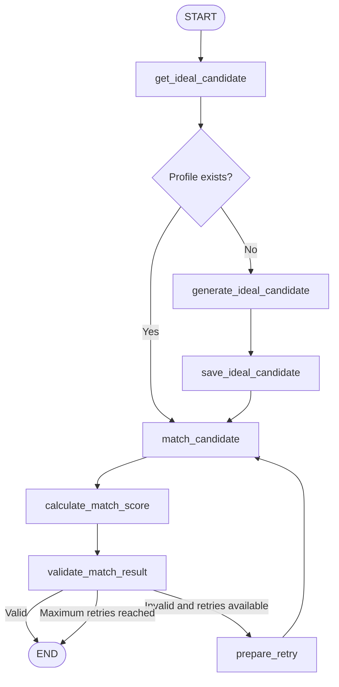

# Matcher Agent

The Matcher Agent is a LangGraph-based recruitment evaluation agent that evaluates candidate profiles against job descriptions (JDs) using an LLM-generated Ideal Candidate profile.

It generates an Ideal Candidate profile for each job description, persists it in the database, and reuses it when evaluating additional candidates for the same JD. Each candidate receives an individual evaluation with section-wise scores, evidence, justifications, and an overall weighted match score.

## Features

- **Ideal Candidate Generation:** Uses an LLM to extract job requirements and construct an Ideal Candidate profile.
- **Database Persistence:** Saves the generated Ideal Candidate profile against its corresponding JD.
- **Profile Reusability:** Retrieves an existing Ideal Candidate profile instead of generating it again for every candidate.
- **Candidate Evaluation:** Evaluates candidates across nine independent sections.
- **Weighted Scoring:** Calculates an overall match score using evaluation weights assigned to each section.
- **Output Validation:** Validates the structure and contents of the LLM-generated matching result.
- **Automatic Retries:** Retries invalid matching results up to two times.
- **JD Isolation:** Maintains a separate Ideal Candidate profile for each job description.

## Architecture

The Matcher Agent is implemented using LangGraph with a state-driven workflow.

### Graph Workflow



### Node Responsibilities

| Node | Responsibility |
|---|---|
| `get_ideal_candidate` | Retrieves the Ideal Candidate profile associated with the JD from the database. |
| `generate_ideal_candidate` | Generates an Ideal Candidate profile using the job description and LLM. |
| `save_ideal_candidate` | Persists the generated profile in the database. |
| `match_candidate` | Evaluates the candidate against the Ideal Candidate profile. |
| `calculate_match_score` | Calculates the weighted overall match score. |
| `validate_match_result` | Validates the matching output and identifies errors. |
| `prepare_retry` | Increments the retry counter and resets validation errors before another attempt. |

## Evaluation Criteria

Each candidate is evaluated across nine sections:

1. Technical Skills
2. Soft Skills
3. Tech Stacks
4. Tools and Platforms
5. Certifications
6. Work Experience
7. Coursework
8. Achievements
9. Education

Each section produces:

- `score`: Evaluation score between 0 and 100.
- `justification`: Explanation of the evaluation.
- `matched_items`: Requirements demonstrated by the candidate.
- `missing_items`: Requirements not demonstrated by the candidate.
- `evidence`: Supporting information from the candidate profile.

## Weighted Match Scoring

The Ideal Candidate profile contains evaluation weights assigned to each section based on the job requirements.

Weights must sum to 100.

The overall match score is calculated using:

\[
OverallScore = \sum_{i=1}^{n}
\left(SectionScore_i \times \frac{Weight_i}{100}\right)
\]

For example, a technical skill section with a score of 80 and a weight of 25 contributes 20 points to the overall score.

The final score is rounded to two decimal places.

## Retry Mechanism

The Matcher Agent validates the generated matching result before completing execution.

If validation errors are detected:

1. The validation node identifies the errors.
2. The graph checks whether retries are available.
3. The retry preparation node increments the retry counter.
4. The matching node executes again.
5. The new result is scored and validated.

The maximum number of retries is **2**, meaning the agent can make up to three matching attempts in total.

If all attempts fail validation, the graph terminates with the remaining validation errors.

## Database Design

The Ideal Candidate profile is associated with its job description using `jd_id`.

Conceptually:

```text
JobDescription
      |
      | 1:1
      |
IdealCandidate
```

The database stores the generated profile, including:

- Technical and soft skills
- Tech stacks
- Tools and platforms
- Certifications
- Work experience
- Coursework
- Achievements
- Education
- Mandatory and preferred requirements
- Minimum experience requirements
- Required education level
- Evaluation weights

This allows multiple candidates applying for the same JD to be evaluated against the same persisted Ideal Candidate profile.

## Project Structure

Relevant Matcher Agent modules:

```text
agents/
├── db/
│   ├── base.py
│   ├── connection.py
│   └── models.py
│
└── matcher/
    ├── graph.py
    ├── nodes.py
    ├── state/
    │   └── matcher_state.py
    ├── schemas/
    │   ├── candidate.py
    │   ├── ideal_candidate.py
    │   └── match_result.py
    └── prompts/
        └── ...
        
tests/
└── matcher/
    ├── test_matcher_graph.py
    └── test_calculate_match_score.py
```

*The structure above highlights the relevant modules; adjust filenames if your local implementation differs.*

## Running Tests

Run all Matcher Agent tests:

```bash
python -m pytest -v tests/matcher/ -s
```

Run the scoring tests:

```bash
python -m pytest -v tests/matcher/test_calculate_match_score.py -s
```

Run the graph integration tests:

```bash
python -m pytest -v tests/matcher/test_matcher_graph.py -s
```

### Tested Scenarios

The test suite covers:

- Generating and saving the first Ideal Candidate profile for a JD.
- Reusing the saved profile for another candidate applying to the same JD.
- Generating a separate Ideal Candidate profile for a different JD.
- Calculating weighted match scores.
- Retrying after an invalid matching response.
- Successfully completing evaluation after a retry.
- Terminating after the maximum retry count.

## Technology Stack

- **Python** – Core implementation.
- **LangGraph** – Agent workflow orchestration.
- **LangChain** – LLM integration and prompt management.
- **Groq** – LLM inference provider.
- **Pydantic** – Structured output schemas and validation.
- **SQLAlchemy** – Database interaction.
- **SQLite** – Local database persistence.
- **Pytest** – Automated testing.

## Execution Flow Summary

The Matcher Agent follows a reusable evaluation process:

1. Receive a candidate profile and job description ID.
2. Retrieve the Ideal Candidate profile from the database.
3. Generate and persist the profile if it does not exist.
4. Evaluate the candidate against the profile.
5. Calculate the weighted match score.
6. Validate the evaluation result.
7. Retry if validation fails and retries remain.
8. Return the final matching result and validation status.

The architecture separates profile generation from candidate evaluation, reducing repeated LLM calls and ensuring consistent evaluation criteria across candidates applying for the same job description.