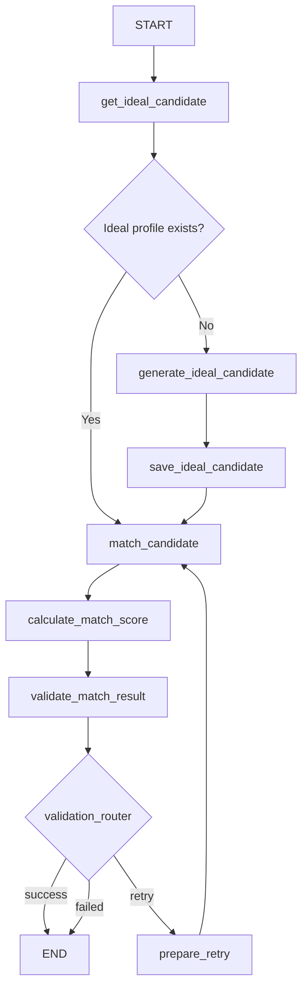

# Matcher Agent

The Matcher Agent evaluates a structured candidate profile against a job-specific ideal candidate profile. It uses LangGraph to orchestrate ideal-profile retrieval or generation, LLM-based section matching, weighted scoring, validation, and bounded retries.

## Position in the pipeline

```text
Resume PDF → Parser Agent → adapt_parser_output() → Matcher Agent → Ranker Agent
                                              ↑
                                       Job description
```

The Parser produces a candidate dictionary. `agents/matcher/adapter.py` maps it into `CandidateState`, retaining identification, contact details, nine evaluation fields, and PEP metadata. The adapter uses direct key lookups, so missing fields raise `KeyError`. The Parser's `technologies` field is not included in the Matcher candidate contract.

## Architecture



`agents/matcher/graph.py` defines and compiles `matcher_graph` using `StateGraph(MatcherState)`.

## Node responsibilities

| Node | Behavior |
| --- | --- |
| `get_ideal_candidate` | Queries `IdealCandidateModel` by `jd_id`; returns the stored profile or `None`. |
| `ideal_candidate_router` | Routes to matching if a profile exists, otherwise to generation. |
| `generate_ideal_candidate` | Uses `generate_ideal_candidate_prompt`, the shared LLM service, and `JsonOutputParser` to produce a job-specific profile. |
| `save_ideal_candidate` | Inserts the generated profile into the database; rolls back on failure. |
| `match_candidate` | Uses `match_candidate_prompt` and the LLM to produce nine section evaluations against the ideal profile. |
| `calculate_match_score` | Computes a weighted overall score and records scoring validation errors. |
| `validate_match_result` | Checks candidate ID, overall score, and the structure and content of all nine sections. |
| `validation_router` | Returns `success`, `retry`, or `failed` based on validation errors and retry count. |
| `prepare_retry` | Increments retry count and clears validation errors before another match attempt. |

## State and data contracts

`agents/matcher/state/` defines:

- `candidate.py` — `CandidateState`: `id`, `name`, `mobile_number`, `email`, optional LinkedIn value, `technical_skills`, `soft_skills`, `tech_stacks`, `tools_and_platforms`, `certifications`, `work_experience`, `coursework`, `achievements`, `education`, `PEP_score`, and `PEP_priority`.
- `ideal_candidate.py` — `IdealCandidate`: the nine role requirements, `mandatory_requirements`, `preferred_requirements`, `minimum_experience_years`, `required_education_level`, and `evaluation_weights`.
- `match_result.py` — `SectionMatch`, `MatchScores`, and `MatchResult`.
- `matcher_state.py` — `MatcherState`: `jd_id`, `job_description`, `candidate`, optional `ideal_candidate`, optional `match_result`, `retry_count`, and `validation_errors`.

The nine independently evaluated sections are:

1. `technical_skills`
2. `soft_skills`
3. `tech_stacks`
4. `tools_and_platforms`
5. `certifications`
6. `work_experience`
7. `coursework`
8. `achievements`
9. `education`

Each `SectionMatch` contains a numeric `score`, a `justification`, and string lists named `matched_items`, `missing_items`, and `evidence`. Scores are intended to range from 0 to 100.

The current `MatchResult` TypedDict contains `candidate_id`, `match_scores`, and `overall_score`. The separate Pydantic `MatchResult` schema additionally declares `eligibility_status`, `recommendation`, and `recommendation_reason`, but the shown graph nodes do not populate those fields.

## Evaluation and scoring

The ideal-candidate prompt assigns non-negative weights across all nine sections, totaling **100**, with higher weights for requirements more relevant to the job description. A section may receive zero weight.

For section scores \(s_i\) and weights \(w_i\), the scoring node calculates:

\[
\text{overall_score} = \operatorname{round}\left(\sum_i s_i \frac{w_i}{\sum_j w_j}, 2\right)
\]

The matching prompt requires a score, short justification, matched requirements, missing requirements, and supporting evidence for every section. It instructs the model not to fabricate qualifications and to treat missing information as unverified.

## Validation and retries

`validate_match_result` checks that:

- `candidate_id` is a nonempty string.
- `overall_score` is finite and between 0 and 100.
- All nine match sections are present.
- Each section has a finite numeric score between 0 and 100 and a nonempty justification.
- `matched_items`, `missing_items`, and `evidence` are lists of strings.

In the provided `nodes.py`, `MAX_RETRIES = 2`, allowing an initial matching attempt plus at most two retries **when validation returns errors**. The graph ends on either success or exhausted retries; callers should inspect `validation_errors` rather than assuming every completed graph run succeeded. Exceptions from the LLM or database are not handled by this validation retry path.

## Usage

The Matcher receives the Parser's output after adaptation. The following illustrates the integration from an asynchronous caller:

```python
from agents.parser.main import process_resume
from agents.matcher.adapter import adapt_parser_output
from agents.matcher.graph import matcher_graph

parsed_candidate = await process_resume(
    pdf=pdf_upload,
    candidate_id="CAND_001",
    pep_score=0,
    pep_priority=0,
)

candidate = adapt_parser_output(parsed_candidate)

result = matcher_graph.invoke({
    "jd_id": "JD001",
    "job_description": job_description,
    "candidate": candidate,
    "retry_count": 0,
    "validation_errors": [],
})

if result.get("validation_errors"):
    raise ValueError(result["validation_errors"])

match_result = result["match_result"]
```

`pdf_upload` and `job_description` must be supplied by the calling application. The example is illustrative, not a standalone runnable script.

## Project files

```text
agents/matcher/
├── adapter.py
├── graph.py
├── main.py
├── nodes.py
├── prompts.py
├── README.md
├── schemas.py
└── state/
    ├── candidate.py
    ├── ideal_candidate.py
    ├── matcher_state.py
    └── match_result.py
```

- `adapter.py`: Parser-to-Matcher field mapping.
- `graph.py`: LangGraph nodes, edges, conditional routes, and compiled graph.
- `nodes.py`: retrieval, generation, matching, scoring, validation, and retry implementations.
- `prompts.py`: instructions for ideal profile generation and evidence-based matching.
- `schemas.py`: Pydantic structures used with `JsonOutputParser`.
- `state/`: TypedDict state contracts.
- `main.py`: example invocation supplied with a job description and candidate data.

## Testing

The Matcher should be tested for both cached and newly generated ideal profiles, valid nine-section output, weighted scoring, invalid section data, bounded retries, and integration with the Parser adapter. Run the Matcher tests from the repository root using the actual test directory in your checkout (for example, `python -m pytest tests/matcher -v` if that directory exists).

## Known implementation limitations

- **Scoring error propagation:** `calculate_match_score` collects scoring errors, but `validate_match_result` initializes a fresh error list. Some scoring errors may be lost before routing. The total-weight check also occurs inside the scoring loop.
- **Weight validation:** The prompt requests weights totaling 100, but the generated profile is not shown undergoing a separate normalization or full validation step before persistence.
- **Schema divergence:** The Pydantic `MatchResult` includes recommendation fields that the actual matching nodes do not generate.
- **Adapter strictness:** Missing Parser keys raise `KeyError`; there is no defaulting or explicit input validation in the adapter.
- **Retry scope:** Only result-validation failures route to retries; LLM parsing exceptions and database errors propagate.
- **Logging:** Debug prints can expose candidate information and model outputs. Remove or redact them in production.
- **Concurrency:** Ideal-profile creation performs a check followed by an insert; concurrent requests for the same new `jd_id` may require uniqueness-conflict handling.

