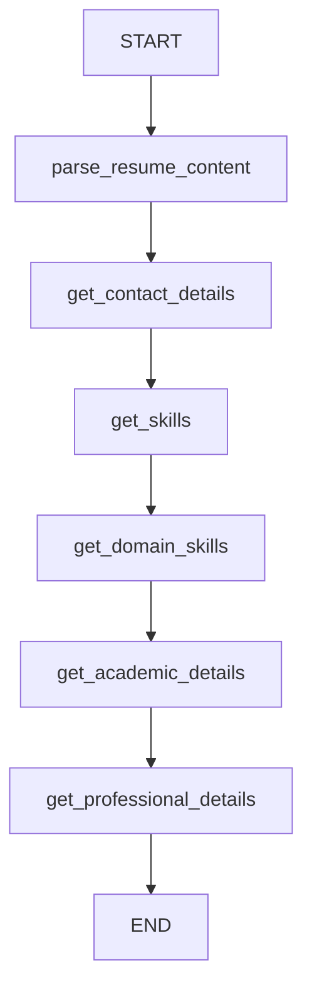

# Resume Parser Agent

The Resume Parser Agent converts a candidate's PDF resume into a structured candidate profile for the recruitment screening pipeline. It extracts page text with **PyMuPDF**, then uses **LangChain prompts, an LLM, and JSON parsing** to extract contact information, skills, academic history, and professional experience.

## Architecture

The agent is implemented as a **sequential LangGraph `StateGraph`**. The graph is compiled in `graph.py` and invoked asynchronously from `main.py`.



There are no conditional edges, retries, or fallback branches in the supplied graph.

## Directory structure

```text
agents/parser/
├── __init__.py
├── graph.py       # Build and compile the LangGraph workflow
├── main.py        # Async process_resume entry point
├── nodes.py       # PDF extraction and five LLM extraction nodes
├── prompts.py     # Extraction instructions and JSON examples
├── schemas.py     # Pydantic extraction schemas
└── state.py       # TypedDict input, output, and graph state
```

## Node responsibilities

| Node | Implementation | Fields produced |
| --- | --- | --- |
| `parse_resume_content` | Opens uploaded PDF bytes with PyMuPDF and collects text from each page | `user_input.resume_content` (`list[str]`) |
| `get_contact_details` | LLM + `get_contact_details_output` parser | `id`, `name`, `mobile_number`, `email`, `linkedin_url` |
| `get_skills` | LLM + `get_skills_output` parser | `technical_skills`, `soft_skills` |
| `get_domain_skills` | LLM + `get_technical_skills_output` parser | `tech_stacks`, `tools_and_platforms` |
| `get_academic_details` | LLM + `academic_skills_output` parser | `education`, `coursework` |
| `get_professional_details` | LLM + `get_professional_details_output` parser | `work_experience`, `achievements`, `certifications` |

The five LLM nodes follow the same pipeline:

```python
prompt = ChatPromptTemplate.from_messages([
    ("system", extraction_prompt),
    ("user", "Resume: {input}"),
])
parser = JsonOutputParser(pydantic_object=output_schema)
result = (prompt | llm_service | parser).invoke({"input": resume_content})
```

`llm_service` is imported from `shared.llm.provider`; the model/provider configuration is defined outside this agent.

## State and data flow

- `PdfDocument`: `filename`, `content_type` (`application/pdf`), and raw PDF `data` bytes.
- `InputState`: candidate resume, candidate ID, extracted page text, and PEP score/priority fields.
- `PartialOutputState`: optional fields that extraction nodes update independently.
- `OverallState`: `id`, `user_input`, and `graph_output`.
- `graph_output` uses `Annotated[PartialOutputState, or_]`: partial dictionaries are combined, with later values overwriting earlier values for duplicate keys. This is a shallow merge, not a recursive merge.

The entry point is:

```python
async def process_resume(
    pdf: UploadFile,
    candidate_id: str,
    pep_score: int,
    pep_priority: int,
):
    ...
```

It reads the uploaded PDF into memory, creates an initial state with empty candidate fields, calls `await resume_graph.ainvoke(initial_state)`, and returns `result["graph_output"]`.

### Example output shape

The following is **illustrative**, not an actual candidate result:

```json
{
  "id": "candidate-001",
  "name": "Example Candidate",
  "mobile_number": "",
  "email": "candidate@example.com",
  "linkedin_url": "",
  "technical_skills": ["Python", "SQL"],
  "soft_skills": ["Communication"],
  "tech_stacks": [],
  "technologies": [],
  "tools_and_platforms": ["Git"],
  "certifications": [],
  "work_experience": [],
  "coursework": ["Database Management Systems"],
  "achievements": [],
  "education": "Bachelor's degree",
  "PEP_score": 0,
  "PEP_priority": 0
}
```

## Prompt rules

The extraction prompts instruct the LLM to use information explicitly present or clearly demonstrated in the resume, avoid fabricating missing details, remove duplicates where appropriate, and return JSON. Missing strings are generally represented as empty strings; missing collections as empty arrays. The contact prompt also instructs the model not to confuse third-party contact details with the candidate's details.

## Dependencies

- Python
- LangGraph (`StateGraph`)
- LangChain Core (`ChatPromptTemplate`, `JsonOutputParser`)
- PyMuPDF (`pymupdf`)
- Pydantic
- FastAPI (`UploadFile`)
- Project LLM service: `shared.llm.provider.llm_service`

Dependency versions and environment variables should be taken from the repository's project-level configuration; they are not defined in the supplied Parser Agent files.

## Tests and verification

From the repository root, use the existing Parser Agent test paths in your project. To discover them on Windows PowerShell:

```powershell
Get-ChildItem tests -Recurse -File | Where-Object { $_.Name -match 'parser|resume|pdf' }
```

Run an identified test file with:

```powershell
python -m pytest path/to/test_file.py -v
```

Recommended coverage includes PDF page extraction, all five extraction outputs, malformed PDFs, malformed LLM JSON, missing fields, and full graph execution. The exact test filenames and current pass counts were not provided for this README.

## Current limitations and follow-up fixes

1. **Coursework schema mismatch:** `academic_skills_output.coursework` is declared `str`, but its prompt requests a JSON array and `OutputState.coursework` is `List[str]`. Standardize this field to `list[str]` across the schema and state.
2. **Technologies field not populated:** The domain prompt describes `technologies`, and `OutputState` includes it, but the JSON example, Pydantic schema, and node return omit it. As written, the initial empty list remains unchanged.
3. **PEP naming mismatch:** `InputState` declares `pep_score` and `pep_priority`, while `main.py` places `PEP_score` and `PEP_priority` under `candidate_resume`. The final `graph_output` does initialize uppercase PEP fields. Normalize the input contract.
4. **No explicit error recovery:** PDF parsing, LLM invocation, and JSON parsing can raise exceptions; the supplied graph has no retry or error-handling nodes.
5. **Debug logging exposes candidate data:** Extraction nodes print full JSON results, including contact information. Remove or redact these logs in production.
6. **PDF validation is not shown here:** `main.py` reads the uploaded file and labels its content type as `application/pdf`; this module does not independently verify MIME type, size, or PDF validity.
7. **Synchronous LLM calls in async graph invocation:** The extraction nodes use `chain.invoke(...)` rather than `ainvoke(...)`. Review this if concurrency or request throughput becomes important.
8. **JSON parsing is not a guarantee of schema validation:** `JsonOutputParser(pydantic_object=...)` uses the schema to guide parsing, but strict Pydantic validation should be verified or enforced separately where required.

## Pipeline role

```text
Uploaded PDF + candidate ID + PEP metadata
    → Parser Agent
    → Structured candidate profile
    → Matcher Agent
    → Ranker Agent
    → Scheduler Agent
```

The Parser Agent is responsible for extraction, not for deciding candidate suitability, ranking applicants, or booking interviews.
