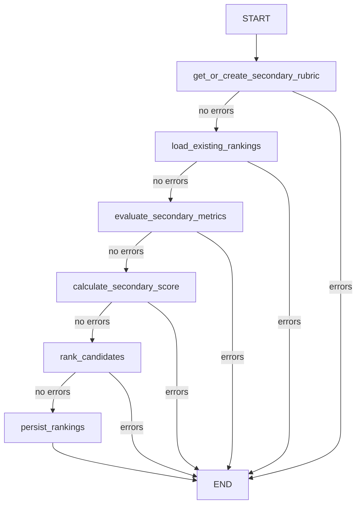

# Ranker Agent

The Ranker Agent evaluates candidates **one at a time** after the Matcher Agent, applies a job-specific secondary rubric, updates the job's leaderboard, and persists rankings using SQLAlchemy.

## Architecture



`graph.py` defines `build_ranker_graph()` and exports the compiled `ranker_graph`. `main.py` is currently empty; the graph is the usable entry point. The graph checks for errors after each node except `persist_rankings`, which returns its errors at the end.

## Directory layout

```text
agents/ranker/
├── graph.py       # LangGraph nodes, edges, error routing, compiled graph
├── main.py        # Currently empty
├── nodes.py       # Rubric, evaluation, scoring, ranking, database operations
├── prompts.py     # Secondary rubric and evaluation LLM prompts
├── schemas.py     # Pydantic output validation
├── state.py       # TypedDict state and result contracts
└── __init__.py
```

## Inputs and state

`RankerState` contains:

| Field | Type / role |
|---|---|
| `jd_id` | Job description identifier |
| `job_description` | Job description text; persisted job text is used when generating a missing rubric |
| `incoming_candidate` | `CandidateState` from the Parser → Matcher pipeline |
| `match_result` | `MatchResult` from the Matcher, including `candidate_id`, nine section matches and `overall_score` |
| `existing_candidates` | Previously persisted `RankedCandidate` records for the job |
| `secondary_rubric` | Job-specific three-criterion rubric |
| `secondary_evaluation` | LLM evaluation plus calculated `weighted_score` |
| `ranked_candidates` | Updated leaderboard |
| `errors` | Optional list of structured `AgentError` records |

The graph populates intermediate fields as it runs. A caller should supply the job, incoming candidate, Matcher result and any required initial state fields appropriate to its integration.

### Matcher → Ranker integration

The Matcher supplies primary evaluation evidence and its weighted `overall_score`. The Ranker also receives the candidate profile to obtain the candidate's name. A typical invocation is:

```python
from agents.ranker.graph import ranker_graph

ranker_input = {
    "jd_id": jd_id,
    "job_description": job_description,
    "incoming_candidate": candidate,  # CandidateState
    "match_result": matcher_output["match_result"],
    "existing_candidates": [],
    "ranked_candidates": [],
    "errors": [],
}

result = ranker_graph.invoke(ranker_input)
if result.get("errors"):
    # Inspect errors before treating ranking as successful.
    print(result["errors"])
else:
    print(result["ranked_candidates"])
```

This is an integration example, not a standalone runnable script: `jd_id`, `job_description`, `candidate`, and `matcher_output` must come from the calling pipeline, and the referenced job must exist in the database.

## Node responsibilities

1. **`get_or_create_secondary_rubric`** — Confirms the job exists in `JobDescription`, retrieves a stored `JobRankingRubric` for the `jd_id`, or generates and persists one from the stored job description. Handles an insertion race through an `IntegrityError` recovery lookup.
2. **`load_existing_rankings`** — Reads `CandidateRanking` records for the job, including the associated candidate name, to reconstruct the existing leaderboard.
3. **`evaluate_secondary_metrics`** — Passes Matcher section evidence, justifications, matched items, and missing items to the LLM with the rubric. Validates the returned criteria and evidence-status scoring rule.
4. **`calculate_secondary_score`** — Validates scores and weights, then calculates the weighted secondary score.
5. **`rank_candidates`** — Inserts or replaces the incoming candidate in the leaderboard, sorts and assigns ranks.
6. **`persist_rankings`** — Inserts or updates `CandidateRanking` records for the job and commits the recalculated leaderboard.

## Secondary rubric

The rubric has **exactly three** criteria:

- `relevant_experience` — Experience relevant to the job.
- `project_impact` — Practical impact demonstrated by projects.
- `problem_solving` — Evidence of analytical and problem-solving ability.

Each criterion has a nonnegative finite `weight`, a nonempty `description`, and nonempty `evaluation_guidelines`. Generated weights are normalized to sum to **1.0**. At least one must be positive. The rubric is reused for subsequent candidates for the same job.

## Secondary evaluation and scoring

For each rubric criterion, the LLM returns a score from **0 to 100**, a justification, and one of four evidence statuses: `sufficient`, `partial`, `insufficient`, or `contradictory`.

An `insufficient` status **must receive a neutral score of 50**; the node rejects other scores for that status. Missing evidence is not automatically interpreted as proof of a missing qualification.

The scoring node calculates:

\[
\text{secondary score} = \operatorname{round}\left(\frac{\sum_i \text{criterion score}_i \times \text{weight}_i}{\sum_i \text{weight}_i}, 2\right)
\]

The calculated score is stored as `secondary_evaluation["weighted_score"]`.

## Ranking policy

The Ranker sorts candidates by:

1. `overall_score` from the Matcher, descending (primary).
2. `secondary_score` from the Ranker, descending (tie-breaker).

It uses **competition ranking**: identical pairs of primary and secondary scores share a rank, and the next rank skips the occupied positions. For example, score pairs `(95, 80)`, `(90, 85)`, `(90, 85)`, `(88, 99)` receive ranks `1, 2, 2, 4`.

When the incoming `candidate_id` is already in the leaderboard, its record is replaced rather than appended. The `one_line_rationale` is taken from the secondary evaluation's `overall_justification`.

## Persistence

- **`JobRankingRubric`** stores a rubric associated with `jd_id`.
- **`CandidateRanking`** stores each candidate's Matcher score and section details, secondary score and evaluation, rank, and rationale for a job.
- `persist_rankings` updates existing records or inserts new ones and commits once after processing the leaderboard.
- Database sessions are closed in `finally` blocks, and database errors are reported through structured agent errors.

## Errors and limitations

Errors are represented as objects with `node`, `error_type`, `message`, and `retryable`. `route_on_error` stops the graph when `errors` is nonempty. **A `retryable` flag is metadata; the current Ranker graph does not implement an automatic retry loop.**

The implementation validates the exact criterion names for generated and stored rubrics. However, `validate_secondary_rubric()` checks the structure and names, not every stored weight or description; stored rubric quality therefore depends on prior validation and persistence. The final persistence node reports errors without an additional routing stage.

## Testing

From the repository root, run the Ranker test suite if it is present:

```powershell
python -m pytest tests/ranker -v
```

Useful coverage areas include rubric creation/reuse, invalid weights, insufficient-evidence scoring, Matcher evidence extraction, score calculation, tie handling, reranking existing candidates, persistence updates, and error routing. This README does not claim that a test run has been executed as part of documentation generation.

## Related agents

- **Parser** extracts candidate data from a resume.
- **Matcher** evaluates the candidate against a job-specific ideal profile and provides the primary score and evidence.
- **Ranker** uses that evidence to break primary-score ties and maintain the leaderboard.
- **Scheduler** consumes ranked candidates for interview scheduling.
