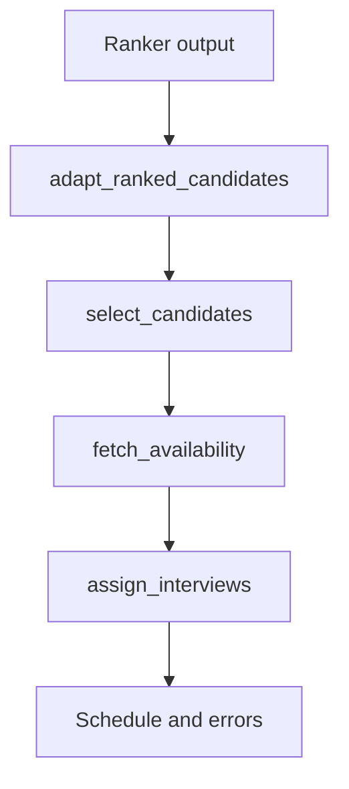

# Scheduler Agent

The Scheduler Agent is the final stage of the Recruitment Screener and Interview Scheduler pipeline. It receives an **already-ranked** candidate list from the Ranker Agent, selects the top candidates, fetches mock interviewer availability, and attempts to book interviews using a simple in-memory booking tool.

> **Implementation status:** The scheduler currently uses hard-coded availability and process-local booking state. It is not connected to a calendar provider and does not send interview invitations.

## Directory structure

```text
agents/scheduler/
├── adapter.py
├── graph.py
├── nodes.py
├── state.py
├── __init__.py
└── tools/
    ├── availability.py
    ├── booking.py
    └── __init__.py
```

## Workflow



`graph.py` compiles a LangGraph `StateGraph(SchedulerState)` with the following fixed sequence:

```text
START → select_candidates → fetch_availability → assign_interviews → END
```

The compiled graph is exported as `scheduler_graph`. There are no conditional graph edges or retry loops; booking fallback happens inside `assign_interviews`.

## Ranker → Scheduler adapter

`adapter.py` defines `adapt_ranked_candidates(ranked_candidates: list[dict]) -> list[dict]`. For each Ranker record, it retains:

| Scheduler field | Ranker field |
| --- | --- |
| `candidate_id` | `candidate_id` |
| `candidate_name` | `candidate_name` |
| `ranking_score` | `overall_score` |
| `rank` | `rank` |

The adapter preserves input order. **The Scheduler does not sort candidates**; `select_candidates` simply takes `ranked_candidates[:top_n]`. The caller must supply the Ranker's correctly ordered leaderboard.

## State contract

`state.py` defines `SchedulerState` as a `TypedDict`:

| Key | Type | Purpose |
| --- | --- | --- |
| `ranked_candidates` | `list[dict]` | Ordered input from the Ranker adapter |
| `top_n` | `int` | Number of candidates to select |
| `selected_candidates` | `list[dict]` | Top candidates selected for scheduling |
| `available_slots` | `list[dict]` | Slots returned by the availability tool |
| `schedule` | `list[dict]` | One scheduling result per selected candidate |
| `errors` | `list[str]` | Booking failure messages |

The state type does not enforce field-level schemas for candidate, slot, or schedule dictionaries.

## Node responsibilities

### `select_candidates(state)`

Reads `ranked_candidates` and `top_n`, returning the first `top_n` candidates as `selected_candidates`. No sorting or eligibility validation is performed in this node.

### `fetch_availability(state)`

Calls `get_available_slots()` and writes the returned list to `available_slots`.

### `assign_interviews(state)`

Iterates through selected candidates in order. For each candidate, it scans available slots in order and calls `book_interview(slot_id, candidate_id)` for slots not yet marked as used during the current scheduling invocation.

- On **successful booking**, it adds a `confirmed` schedule entry with the slot and interviewer details.
- On **failed booking**, it records an error, marks that slot as used for this invocation, and attempts the next slot.
- If **no slot can be booked**, it adds a `pending` entry with `interview_slot: None` and `interviewer: None`.

`used_slots` is a local set shared across candidates in a single call to `assign_interviews`, avoiding repeated attempts at the same slot within that call. The booking tool's global `booked_slots` set handles bookings remembered across calls in the same process.

The node returns `schedule` and `errors`. The graph does not branch on errors.

## Scheduling tools

### `tools/availability.py`

`get_available_slots() -> list[dict]` returns **five hard-coded slots** on **November 20, 2026**, each lasting 30 minutes:

| Slot | Time | Interviewer |
| --- | --- | --- |
| `SLOT_001` | 10:00–10:30 | John (`INT_001`) |
| `SLOT_002` | 10:30–11:00 | Sarah (`INT_002`) |
| `SLOT_003` | 11:00–11:30 | John (`INT_001`) |
| `SLOT_004` | 11:30–12:00 | David (`INT_003`) |
| `SLOT_005` | 12:00–12:30 | Sarah (`INT_002`) |

The `start_time` and `end_time` values are naive Python `datetime` objects (no timezone information). The tool does not check the current date, calendar conflicts, interviewer schedules, or external availability.

### `tools/booking.py`

`book_interview(slot_id: str, candidate_id: str) -> dict` uses a module-level `booked_slots = set()`:

- If `slot_id` is already in the set, it returns `{"success": False, "message": "Slot already booked"}`.
- Otherwise, it adds `slot_id` to the set and returns success, slot ID, candidate ID, and a confirmation message.

The tool does not validate whether a slot ID exists in the availability list. Bookings are not persisted to a database and are lost when the process restarts. The in-memory set is not a concurrency-safe replacement for an atomic database reservation.

## Example invocation

```python
from agents.scheduler.adapter import adapt_ranked_candidates
from agents.scheduler.graph import scheduler_graph

# Supply Ranker results in the order produced by the Ranker.
ranker_output = [
    {
        "candidate_id": "CAND_001",
        "candidate_name": "Alice",
        "overall_score": 94.0,
        "rank": 1,
    },
    {
        "candidate_id": "CAND_002",
        "candidate_name": "Bob",
        "overall_score": 89.0,
        "rank": 2,
    },
]

scheduler_input = {
    "ranked_candidates": adapt_ranked_candidates(ranker_output),
    "top_n": 2,
    "selected_candidates": [],
    "available_slots": [],
    "schedule": [],
    "errors": [],
}

result = scheduler_graph.invoke(scheduler_input)
print(result["schedule"])
print(result["errors"])
```

This example uses the fixed mock slots; its booking outcomes depend on the process-local `booked_slots` set at invocation time. To reset that state **in tests**, use `booked_slots.clear()` from `agents.scheduler.tools.booking`.

## Schedule output

Each selected candidate receives one entry. A successful entry has the following structure:

```python
{
    "candidate_id": "CAND_001",
    "candidate_name": "Alice",
    "interview_slot": {
        "slot_id": "SLOT_001",
        "start_time": datetime(2026, 11, 20, 10, 0),
        "end_time": datetime(2026, 11, 20, 10, 30),
    },
    "interviewer": {
        "interviewer_id": "INT_001",
        "interviewer_name": "John",
    },
    "status": "confirmed",
}
```

A candidate who cannot be assigned receives:

```python
{
    "candidate_id": "CAND_002",
    "candidate_name": "Bob",
    "interview_slot": None,
    "interviewer": None,
    "status": "pending",
}
```

`errors` is a list of strings describing failed booking attempts; a recovered booking failure may appear in `errors` even if the candidate ultimately receives a confirmed slot.

## Testing considerations

Useful scenarios for the existing mock implementation include:

1. Select only the first `top_n` candidates from an already-ranked list.
2. Confirm successful bookings use distinct slots.
3. Pre-book a slot, then verify the scheduler falls back to the next slot and records the failure.
4. Provide fewer usable slots than selected candidates and verify `pending` entries.
5. Reset `booked_slots` between tests to prevent cross-test interference.

Example test command (when tests exist in the corresponding path):

```bash
python -m pytest tests/scheduler -v
```

## Current limitations and possible extensions

- **Static dates:** All five mock slots are dated November 20, 2026. The implementation can offer past slots because it does not filter by current time.
- **No timezone handling:** Slot datetimes are naive.
- **No external calendar:** Availability and booking are mock functions, not Google Calendar or another calendar service.
- **No durable state:** Bookings are stored only in memory and disappear on process restart.
- **No atomic reservation:** The set-based booking mechanism is not safe for concurrent workers or multiple processes.
- **No invitation delivery:** The scheduler does not email candidates or interviewers.
- **No scheduler-side sorting:** It trusts the Ranker's candidate order.
- **Limited validation:** `top_n`, slot payloads, candidate fields, and slot validity are not explicitly validated by these nodes.

A production extension could replace the two tool implementations with real availability and atomic booking integrations while retaining the graph's three-stage orchestration contract.
