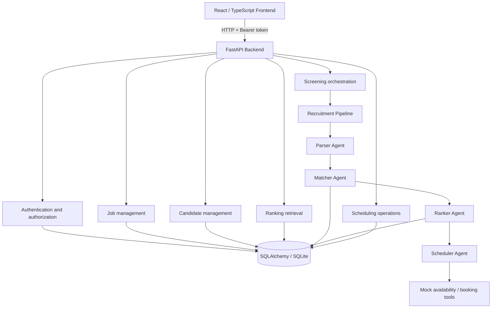
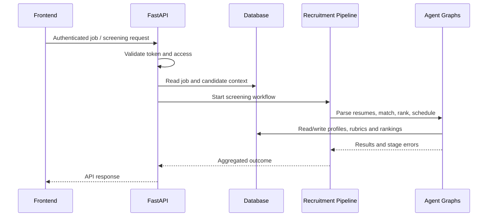

# Backend — Recruitment Screener and Interview Scheduler

The backend is the API and persistence layer for a recruitment workflow that accepts job descriptions and candidate information, coordinates AI-assisted screening, stores rankings, and supports interview scheduling.

> **Scope:** This is an architecture-level README based on the known project design. Exact endpoint paths, request/response schemas, startup commands, and integration configuration should be checked against the current backend code before deployment.

## Architecture



The API exposes application operations; the agents live in the separate `agents/` package and are coordinated by the recruitment pipeline. This separation keeps HTTP request handling distinct from AI evaluation and scheduling logic.

## Responsibilities

| Area | Responsibility |
| --- | --- |
| Authentication | Register/login users and issue or validate access tokens |
| Authorization | Restrict protected operations to authenticated users and enforce job ownership where implemented |
| Job management | Create and retrieve job descriptions and associated metadata |
| Candidate management | Store candidate contact details and link candidate records to screening workflows |
| Screening orchestration | Invoke Parser → Matcher → Ranker → Scheduler and report stage results or errors |
| Ranking | Persist and retrieve job-specific candidate scores, rationales, and ranks |
| Scheduling | Surface interview assignments and scheduling outcomes |
| Integrations | Support project-specific data ingestion or synchronization (for example, Google Sheets/Drive where configured) |

## Request and data flow



The actual screening trigger, synchronous versus background execution, and response payload depend on the route implementation; this diagram shows the conceptual architecture, not a guaranteed single HTTP transaction.

## Data model overview

The known persistence layer uses **SQLAlchemy** with **SQLite** during development. The project includes these model concepts:

- **JobDescription:** Job posting and description used to derive evaluation criteria.
- **Candidate:** Candidate identity and contact information, including a source-response identifier for ingestion/deduplication.
- **IdealCandidateModel:** One generated ideal-candidate profile per job description, reused by the Matcher.
- **JobRankingRubric:** One secondary evaluation rubric per job description, reused by the Ranker.
- **CandidateRanking:** Job/candidate-specific primary score, secondary score, evidence, rationale, and rank; the job–candidate pair is unique.

These models support reusable job-specific evaluation criteria and a persistent leaderboard. Consult the model definitions for the exact columns, constraints, and relationships.

## Authentication and frontend integration

The frontend uses a centralized Axios client configured with:

```env
VITE_API_BASE_URL=http://127.0.0.1:8000
```

It reads `access_token` from `sessionStorage` and sends `Authorization: Bearer <token>` on API requests. The backend must validate the token and enforce authorization independently; a frontend route guard is not a security boundary.

The backend must also configure CORS for the frontend origin when the applications run on different origins. Confirm allowed origins and credential behavior in the actual FastAPI configuration.

## Agent integration

### Parser

Consumes resume PDF data and candidate identifiers, extracts PDF text, and produces structured candidate information through LLM-assisted parsing.

### Matcher

Uses a job-specific ideal candidate profile and the parsed candidate data to evaluate nine matching sections. It validates section-level evidence and computes the primary match score.

### Ranker

Receives one matched candidate at a time, retrieves or generates a three-criterion secondary rubric (`relevant_experience`, `project_impact`, `problem_solving`), evaluates evidence, computes a secondary score, and updates job-specific competition rankings in the database.

### Scheduler

Selects the top `N` candidates from the ranked list and attempts to allocate interview slots. The current agent's availability and booking tools are mocks; booking state is an in-memory set and is **not** a persistent calendar integration.

See [`../agents/README.md`](../agents/README.md) for the full cross-agent architecture and individual agent READMEs for node-level details.

## Failure handling and operational boundaries

The pipeline is designed to report errors by processing stage rather than treating every candidate failure as a successful screening. The Matcher validates its LLM output, the Ranker stops its graph when errors are recorded, and the Scheduler can mark unassigned candidates as `pending`.

Production-readiness concerns include:

- **Idempotency:** Avoid duplicate candidate ingestion, repeated screening side effects, and duplicate bookings.
- **Transactions and concurrency:** Handle concurrent rubric creation and ranking updates safely; protect scheduling from double booking across processes.
- **Long-running work:** Consider background jobs, durable execution, and progress tracking for PDF parsing and LLM calls.
- **Security:** Validate file types and sizes, enforce authorization for every resource, protect tokens and secrets, and avoid logging candidate personal data.
- **Observability:** Add request/correlation IDs, stage-level timings, structured logs, and failure metrics.
- **External integrations:** Handle API credentials, retries, quotas, and synchronization failures explicitly.

## Local development

The project uses Python and FastAPI. The precise installation and launch commands should be taken from the repository's dependency and application-entry files. A typical local workflow is:

1. Create and activate a Python virtual environment.
2. Install dependencies from the repository's Python dependency manifest.
3. Configure the database URL, token-signing secret, LLM provider credentials, and optional Google integration credentials.
4. Initialize the database using the project's configured schema/migration procedure.
5. Start the FastAPI application using its actual ASGI module path.
6. Start the frontend separately and set `VITE_API_BASE_URL` to the backend origin.

**Do not copy an assumed `uvicorn` import path or environment variable name into deployment scripts without checking the source.**

## Testing

The project has used `pytest` for agent and integration testing, including Matcher validation/retry cases, Ranker scoring and persistence, Scheduler booking fallback, and pipeline-level tests. From the repository root, a broad test invocation is:

```bash
python -m pytest
```

Run targeted test paths that exist in the current checkout when debugging a particular subsystem. Mock LLM calls and external integrations for deterministic tests; use an isolated test database for persistence checks.

## Related documentation

- [`../agents/README.md`](../agents/README.md) — end-to-end agent architecture
- [`../agents/parser/README.md`](../agents/parser/README.md) — resume parsing
- [`../agents/matcher/README.md`](../agents/matcher/README.md) — primary matching
- [`../agents/ranker/README.md`](../agents/ranker/README.md) — secondary ranking
- [`../agents/scheduler/README.md`](../agents/scheduler/README.md) — interview assignment
- [`../frontend/README.md`](../frontend/README.md) — frontend architecture

## Documentation status

This README intentionally describes the **backend architecture** without claiming unverified route names, exact directory layout, environment variables, or deployment procedures. Update those sections from the actual backend source when a source-level API reference is needed.
