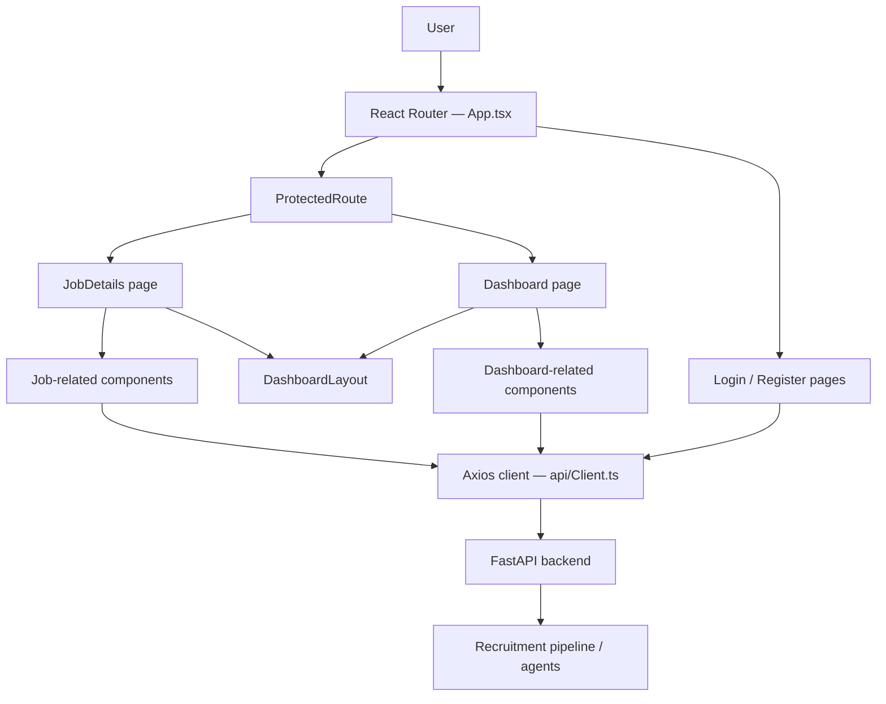
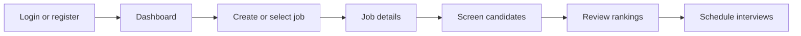
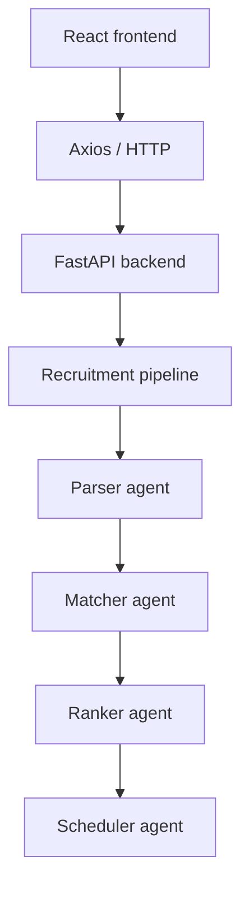

# Frontend — Recruitment Screener & Interview Scheduler

A React and TypeScript web interface for the Recruitment Screener and Interview Scheduler. The frontend provides authentication screens and a workspace for job-related recruitment workflows, with an Axios client for communicating with the FastAPI backend.

> **Documentation scope:** This README describes the confirmed frontend structure and architecture. The responsibilities of feature components are inferred from their names; their detailed behavior and backend endpoints have not been verified from their source files.

## Technology stack

| Layer | Technology |
| --- | --- |
| UI | React 19, TypeScript 7 |
| Build and development | Vite 8 |
| Routing | React Router 7 |
| Styling | Tailwind CSS 4 |
| HTTP client | Axios |
| Icons | Lucide React |
| Linting | oxlint |
| Backend | FastAPI (accessed over HTTP) |

## Architecture



The diagram represents the application layers and intended integration. The exact imports and API calls of individual pages and components were not inspected.

### Core architectural responsibilities

1. **Routing and access control (`App.tsx`)** — Defines public authentication routes and token-presence checks for protected routes.
2. **Pages (`pages/`)** — Organize the user-facing screens.
3. **Components (`components/`)** — Separate reusable layout and recruitment features from page-level composition.
4. **API layer (`api/Client.ts`)** — Centralizes backend URL configuration and attaches the bearer token to requests.
5. **Backend** — Receives requests and handles server-side authorization and recruitment processing.

## Project structure

```text
frontend/
├── public/                         # Static assets
├── src/
│   ├── App.tsx                     # Routes and ProtectedRoute
│   ├── main.tsx                    # Application entry point
│   ├── index.css                   # Global styles
│   ├── api/
│   │   └── Client.ts               # Configured Axios client
│   ├── components/
│   │   ├── CandidateRankings.tsx
│   │   ├── CreateJobForm.tsx
│   │   ├── DashboardLayout.tsx
│   │   ├── DashboardStats.tsx
│   │   ├── InterviewScheduler.tsx
│   │   └── ScreenCandidatesButton.tsx
│   └── pages/
│       ├── Dashboard.tsx
│       ├── JobDetails.tsx
│       ├── Login.tsx
│       └── Register.tsx
└── package.json
```

`node_modules/` contains installed dependencies and should not be committed.

## Routing and authentication

The routes in `App.tsx` are:

| Route | Screen | Access |
| --- | --- | --- |
| `/login` | Login | Public |
| `/register` | Register | Public |
| `/dashboard` | Dashboard | Protected |
| `/jobs/:jobId` | Job details | Protected |
| Any other path | Redirect to `/login` | — |

`ProtectedRoute` reads `sessionStorage.getItem("access_token")`. If the token is absent, it redirects to `/login` using React Router's `Navigate` component. This is a **client-side presence check**, not token validation; the backend must independently verify credentials and permissions.

The shared `DashboardLayout` provides a responsive sidebar, a Dashboard navigation link, and a logout action. Logging out removes `access_token` from session storage and navigates to `/login`.

## Feature areas

The following are the intended responsibilities suggested by the current file organization. Exact UI behavior and API endpoints should be verified against the corresponding source files before claiming they are fully implemented.

| File | Architectural role |
| --- | --- |
| `pages/Login.tsx` | Authentication screen |
| `pages/Register.tsx` | Registration screen |
| `pages/Dashboard.tsx` | Recruitment workspace / dashboard |
| `pages/JobDetails.tsx` | Job-specific workspace, selected by `jobId` route parameter |
| `components/DashboardStats.tsx` | Dashboard statistics presentation |
| `components/CreateJobForm.tsx` | Job creation form |
| `components/ScreenCandidatesButton.tsx` | Candidate screening action |
| `components/CandidateRankings.tsx` | Candidate rankings presentation |
| `components/InterviewScheduler.tsx` | Interview scheduling UI |
| `components/DashboardLayout.tsx` | Shared navigation and page layout |

### Intended user journey



This is a high-level product flow, not a verified sequence of frontend events.

## API communication

`src/api/Client.ts` creates a shared Axios instance:

```ts
import axios from "axios";

const api = axios.create({
  baseURL: import.meta.env.VITE_API_BASE_URL || "http://127.0.0.1:8000",
});

api.interceptors.request.use((config) => {
  const token = sessionStorage.getItem("access_token");
  if (token) {
    config.headers.Authorization = `Bearer ${token}`;
  }
  return config;
});

export default api;
```

The API client automatically attaches `Authorization: Bearer <token>` when a token is present. It does not, in the reviewed code, implement automatic token refresh, a global response-error handler, or retry logic.

### Backend and agents relationship

The frontend communicates with the **FastAPI backend**, not directly with individual LangGraph agents. The backend is responsible for exposing operations that can invoke the recruitment pipeline:



The exact frontend endpoints and triggering conditions are not documented here because their implementations were not provided.

## Running locally

### Prerequisites

- Node.js and npm compatible with the project's Vite version.
- A running FastAPI backend for API-backed features.

From the repository root:

```bash
cd frontend
npm install
npm run dev
```

Open the local URL printed by Vite.

### Environment configuration

Create `frontend/.env.local` if the backend is not using the default address:

```dotenv
VITE_API_BASE_URL=http://127.0.0.1:8000
```

Vite exposes variables prefixed with `VITE_` to frontend code. Do not put private API keys or secrets in these variables.

### Other commands

```bash
npm run build    # TypeScript build check + Vite production build
npm run preview  # Preview the production build locally
npm run lint     # Run oxlint
```

## Security and reliability notes

- **Authentication:** Route guards only check for a token's presence. The server must validate tokens and enforce authorization for each API request.
- **Token storage:** `sessionStorage` is browser-accessible; prevent cross-site scripting and avoid logging tokens.
- **Error handling:** Centralized response handling and token-expiry behavior were not present in the reviewed API client.
- **CORS:** The backend must allow requests from the frontend development origin where appropriate.
- **Scheduling:** The underlying Scheduler agent currently uses mock availability and in-memory booking. The frontend should not present those results as calendar-confirmed appointments unless a real booking integration is implemented.
- **Implementation verification:** Feature names indicate intended responsibilities but do not prove complete behavior; review component source and test end-to-end flows before deployment.

## Documentation map

- [`../agents/README.md`](../agents/README.md) — Overall multi-agent architecture.
- [`../agents/parser/README.md`](../agents/parser/README.md) — Resume parsing.
- [`../agents/matcher/README.md`](../agents/matcher/README.md) — Candidate matching.
- [`../agents/ranker/README.md`](../agents/ranker/README.md) — Ranking and persistence.
- [`../agents/scheduler/README.md`](../agents/scheduler/README.md) — Interview scheduling.

## Suggested future improvements

Add automated route/component tests, documented API request/response contracts, consistent loading and error states, token-expiry handling, and production scheduling integration as the frontend matures.
